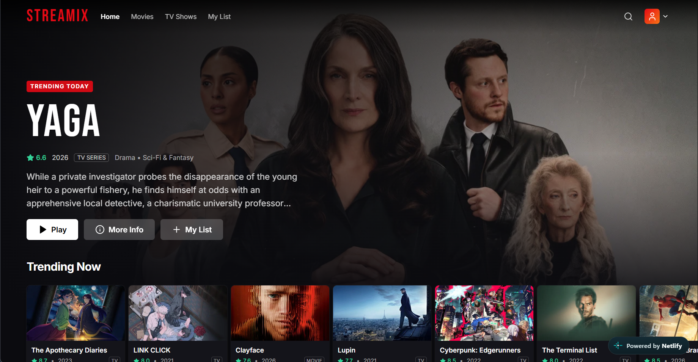

# Streamix

A cinematic, Netflix-inspired streaming UI built with **React, Vite and Tailwind CSS**, powered by real data from the **TMDB API**. Browse trending titles, watch trailers, search, filter by genre and keep a personal watch list that survives page refreshes.

> Streamix is a front-end portfolio project. It is not affiliated with Netflix, and it does not host or stream any videos (trailers are embedded from YouTube).

**[🔗 Live Demo](https://streamix-hazim.netlify.app/)** · [Source code](https://github.com/hazell-lab/Streamix) · [Portfolio](https://hazimaqil-portfolio.netlify.app)



## Features

- **Home** – transparent navbar that turns solid on scroll, a random trending hero banner, and horizontal rows: Trending Now, Popular Movies, Top Rated, Now Playing, Upcoming, Popular TV Shows
- **Smooth carousels** – left/right arrows, smooth scrolling, arrows appear only when there is more to scroll
- **Movie cards** – hover-to-enlarge animation, play trailer, add to My List, details button, lazy-loaded images with fallbacks
- **Details pages** (`/movie/:id`, `/tv/:id`) – backdrop, poster, rating, runtime/seasons, genres, cast, trailer, similar and recommended titles
- **Search** – debounced multi-search (movies + TV), loading skeletons, empty state, error handling, "Load more", shareable `?q=` URLs
- **Movies & TV Shows pages** – curated rows plus genre filtering and sorting, both stored in the URL (e.g. `/movies?genre=28&sort=vote_average.desc`) so links can be shared, with pagination
- **My List** – add/remove titles, persisted in LocalStorage and kept in sync across open tabs
- **Trailer modal** – YouTube trailer from TMDB; closes with the X button, a click outside, or `Esc`; keeps keyboard focus inside while open and returns it to the button that opened it
- **Extras** – Recently Viewed row, Continue Watching (mock) row, toast notifications, scroll-to-top button, 404 page, page fade transitions, custom scrollbar
- **Responsive** – desktop, laptop, tablet and mobile, with a mobile menu
- **Fast first load** – every page except Home is code-split with `React.lazy`, so it is only downloaded when visited
- **Accessible** – ARIA labels, visible focus states, `Esc` closes menus and dialogs, and animations switch off when the OS "reduce motion" setting is on

## Tech stack

| Tool | Purpose |
| --- | --- |
| React 18 + Vite | UI and dev tooling |
| JavaScript (ES2022) | Language |
| Tailwind CSS 3 | Styling |
| React Router 7 | Routing |
| Axios | HTTP client |
| TMDB API | Movie and TV data |
| Lucide React | Icons |
| LocalStorage | My List + Recently Viewed |
| ESLint 9 | Linting (React + Hooks rules) |
| Node test runner | Unit tests for helper functions |

## Installation

Requires **Node.js 20.19 or newer**.

```bash
git clone https://github.com/hazell-lab/Streamix.git
cd Streamix
npm install
```

## Environment setup

1. Copy the example file:
   ```bash
   cp .env.example .env
   ```
2. Open `.env` and paste your TMDB key:
   ```env
   VITE_TMDB_API_KEY=your_key_here
   ```

The key is read only in `src/services/tmdb.js`, never inside components. `.env` is git-ignored.

### TMDB API setup

1. Create a free account at <https://www.themoviedb.org/signup>.
2. Go to **Settings → API** (<https://www.themoviedb.org/settings/api>).
3. Click **Create** / **Request an API key**, choose **Developer**, and fill in the short form (a personal portfolio project is fine).
4. Copy the **API Key (v3 auth)** – the shorter one, *not* the long "Read Access Token".
5. Paste it into `.env` as shown above.

## Running locally

```bash
npm run dev       # start the dev server (http://localhost:5173)
npm run build     # production build in /dist
npm run preview   # preview the production build
npm run lint      # check the code with ESLint
npm test          # run the unit tests in tests/
```

Restart `npm run dev` after editing `.env`.

## Project structure

```
Streamix/
├── docs/                    # README screenshot
├── public/                  # favicon + SPA redirect files (Netlify / Vercel)
├── src/
│   ├── assets/              # placeholder image used as a fallback
│   ├── components/          # Navbar, Hero, MovieRow, MovieCard, MovieGrid, TrailerModal,
│   │                        # SearchBar, LoadingSkeleton, ErrorMessage, Footer, GenreFilter, ...
│   ├── context/             # MyList, RecentlyViewed, Toast and Trailer providers
│   ├── hooks/               # useFetch, useDebounce, useLocalStorage, useDiscover, ...
│   ├── pages/               # Home, Movies, TVShows, Details, Search, MyList, NotFound
│   ├── services/tmdb.js     # every TMDB request lives here
│   ├── utils/helpers.js     # image URLs, formatting, small pure functions
│   ├── App.jsx              # layout + routes
│   └── main.jsx             # providers + router
├── tests/                   # unit tests (Node's built-in test runner)
├── .env.example
├── eslint.config.js
├── tailwind.config.js
└── vite.config.js
```

## Deploying

`public/_redirects` (Netlify) and `vercel.json` (Vercel) rewrite every route to `index.html`, so refreshing on `/movie/123` works in production. Add `VITE_TMDB_API_KEY` as an environment variable in your hosting dashboard.

> Note: any `VITE_` variable is bundled into the JavaScript the browser downloads, so the TMDB key is visible to anyone who inspects the site. That is normal for a front-end-only TMDB project (the key is free and read-only), but never put a secret key in a `VITE_` variable.

## What I learned

- Structuring a React app into components, pages, hooks, context and a service layer
- Writing custom hooks (`useFetch`, `useDebounce`, `useLocalStorage`, `useDiscover`) and handling race conditions with cleanup flags
- Sharing global state with the Context API (My List, toasts, trailer modal) without prop drilling
- Routing with React Router: dynamic params, query strings, 404 pages, scroll restoration, lazy-loaded routes
- Centralising API calls with Axios, friendly error messages, and a tiny request cache
- Building responsive, accessible UI with Tailwind (focus states, ARIA labels, keyboard support, focus trapping, reduced motion)
- Linting with ESLint and writing unit tests for pure functions
- Loading, empty and error states for every async view

## Future improvements

- User accounts and cloud-synced lists
- Infinite scroll instead of "Load more"
- Actor pages and "watch providers" info
- Component tests (Vitest + React Testing Library)
- Keyboard navigation inside carousels
- TypeScript migration
- PWA / offline support

## Credits

This product uses the TMDB API but is not endorsed or certified by TMDB. Movie data and images are provided by [The Movie Database](https://www.themoviedb.org).

## Author

Built by **Hazim Aqil**, Software Engineering student at the German-Malaysian Institute (GMI).

- Portfolio: [hazimaqil-portfolio.netlify.app](https://hazimaqil-portfolio.netlify.app)
- GitHub: [@hazell-lab](https://github.com/hazell-lab)
- LinkedIn: [mdhazimaqil](https://www.linkedin.com/in/mdhazimaqil/)
